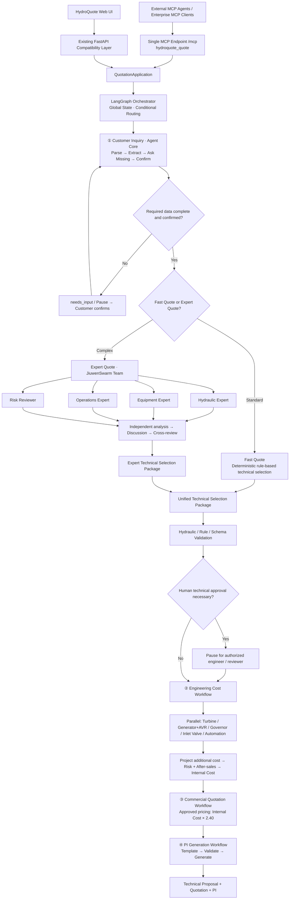

# HydroQuote AI · v2 总体重构方案（LangGraph Orchestrator + JiuwenSwarm Expert Quote）

**项目**：https://github.com/linmanshan050813-dotcom/HydroQuote  
**实施工具**：Cursor Agent（独立执行，不需要其他开发 Agent）  
**状态**：实施规格；未修改原仓库、未完成实际联调。 

## 1. 最终目标与不可变边界

保留原 HydroQuote 的 Web UI、FastAPI 入口、文本或 PDF/DOCX 项目书输入、定版技术选型范围和商业报价公式；将旧单体演示分析和 Prompt-only 估价重构为 **LangGraph 主工作流 + Agent Core 子工作流 + JiuwenSwarm 复杂技术专家协作 + 精确 Python Costing Engine**；将**整笔报价能力**以一个 MCP Server 的一个工具提供给外部 Agent 与企业系统。

**唯一主流程：** `Customer Inquiry → Technical Selection (Fast Quote / Expert Quote) → Engineering Cost → Commercial Quotation → PI Generation → Technical Proposal + Quotation + PI`。

**技术权属**：

| 技术 | 唯一职责 | 不允许做的事 |
|---|---|---|
| **LangGraph** | 全局有状态编排、条件路由、并行核价、暂停/恢复、人工审核 | 不承担公式解释的权威来源或让 LLM 直接算钱 |
| **openJiuwen Agent Core** | Inquiry Agent + 标准项目 Engineering 子流程 + 报价辅助子组件/WorkflowAgent | 不再作为第二套全局 Orchestrator |
| **JiuwenSwarm Agent Team** | 仅 **Expert Quote 复杂技术选型**：四专家独立分析、讨论、交叉审核 | 不为每笔普通订单启动、不替代定价函数、不自行批准正式报价 |
| **Python Domain Layer** | 水力校核、技术选型规则、五设备底价、附加成本、风险与商务价格、PI 数据校验 | 不读取 LLM 无校验的自由文本直接入账 |
| **MCP** | 一个外部入口 `/mcp` 和一个 `hydroquote_quote` Tool；兼容其他 MCP Client | 不暴露底层全部内部计算工具或内部利润/成本 |

## 2. 最终业务流程：与本次给出的方案逐字对齐



**路由原则**：缺关键参数优先返回 `needs_input`，**不要**把没有净水头/流量的询盘直接扔给 Swarm 猜测。参数完整后，使用**可解释、规则化的复杂度分类器**决定 Fast/Expert。技术选型完成后两条路径必须汇合到同一 `TechnicalSelectionPackage`，才允许进入五设备报价阶段。

**人工审核**：复杂方案不自动等于人工批准；若超出工程适用范围/核价区间/合同条款不全，LangGraph 必须调用可恢复的审核门控。Swarm 产出的是建议与交叉审查记录，不具有商业批准权限。

## 3. 标准与复杂项目路由（可配置，不能凭 LLM 偶然判断）

### Fast Quote：优先条件

- 必填业务、水力、电气信息已经确认，输入没有重大矛盾。
- 已审定的水头/流量/机型/机组组合规则可以覆盖该项目；无需复杂的泥沙、特殊工况或多变量权衡。
- 技术风险低，数据足够选择一个主推荐机型。

### Expert Quote：复杂度信号（以下是**实施建议**，并非新增定版工程阈值）

- 多机组合间存在明显的枯水期运行、检修冗余、容量分配冲突。
- 高含沙量/强磨蚀、水文季节波动、特殊运转方式、特殊控制要求。
- 高水头/低水头边界工况、多种机型技术可行且取舍不明确。
- 水力功率与目标装机明显冲突、工程规范超出当前规则覆盖。
- 客户明确要求专家技术论证。

以 `complexity_rules.yaml` 保存经审核的路由条件、阈值和版本；若条件无法判定，进入 **expert_quote 或人工技术确认**，不能伪装为 Fast Quote。允许模型提供“推荐复杂度理由”，但最终由规则检查节点决策，所有因素写入 trace。

> 与价格规则分开：**技术复杂度路由**和**定价人工复核**是两种不同关口。标准项目也可能因为成本公式仅给了价格范围而进入 `review_required`，无需强制进入 Swarm。

## 4. Agent Core 在新主架构中的位置

保留真实 Agent Core 技术使用，采用两个专业能力域，但**LangGraph 逐节点调度**：

1. **EngineeringAgent（Agent Core WorkflowAgent）**：客户询盘文本/项目书信息提取、标准化与追问所需字段；在 Fast Quote 路径调用规则引擎输出初步技术方案及解释。`WorkflowAgent.invoke` 的输出经 Pydantic 校验。
2. **QuotationAgent（Agent Core WorkflowAgent / 工作流组件）**：辅助整理工程成本计算记录、商务说明、PI 描述；所有金额来自确定性 Python Domain Layer 的结果。LangGraph 明确负责何时调用 Cost/Commercial/PI 节点，Agent Core 不能再运行一套重复的主流程。

如果 QuotationAgent 拆成 3 个子工作流，仍属于内部能力，不应形成又一份 independently driven end-to-end quotation orchestrator。

## 5. Expert Quote · JiuwenSwarm（必须是真实协作）

**Team Roles**：`Hydraulic Expert` / `Equipment Expert` / `Operations Expert` / `Risk Reviewer`；增加 `Swarm Leader` 仅做分解任务、组织讨论与提交整合结果。四专家必须**先独立分析**，再讨论和交叉审核，避免早期共识污染。

**输入**：合法来源的 `QuoteDraft`/经脱敏的 Inquiry 字段 + `quote_id` + `rule_version` + `routing_reasons`（无内部成本、真实凭据、个人敏感信息）。

**输出**：唯一结构化 `TechnicalSelectionPackage`：`turbine_type`、`unit_count`、`unit_capacity_kw`、`hydraulic_calculation`、`equipment_scope`（五项）、`automation_scope`、`assumptions`、`risks`、`expert_opinions`、`cross_review`、`technical_approval_required`、`source_provenance`。这个包必须经过 **Schema/规则/物理校核**；Swarm 不能绕过校核直接进入报价。

**真实集成路径**：优先使用 JiuwenSwarm 已有的 CLI `jiuwenswarm chat --mode team --session <id> --json --timeout <seconds> "..."` 实现本地 **SwarmAdapter** 验证；官方还提供 A2A Gateway，可在生产环境进行版本化、鉴权与并发测试之后升级。CLI 共享 `/tui` 通道，不能无条件支持多个并发报价：MVP 用队列限流/串行执行，独立进程，超时可回到 `review_required`；生产不得直接照搬无鉴权 CLI/单通道部署。

JiuwenSwarm 可以通过 MCP `get` 读取受授权的待审案例，但**不允许再通过 `create` 递归触发同一个 Swarm**。Leader 从 CLI/A2A Adapter 返回结构化技术方案，LangGraph 将其存为候选，继续校核。具体见 `04_JiuwenSwarm_复杂选型集成.md`。

## 6. 报价标准（必须保留原有规则）

主报价单固定五项：`Hydro Turbine`、`Generator and Exciter / AVR`、`Speed Governor`、`Inlet Valve`、`Automation System`。Standard PLC Automation 为默认标准配置，Advanced SCADA 仅可作为 Optional Upgrade 列示，不要默认为基础五项新增一项。

- 每项设备底价严格来自原《报价规则.docx》；特别是 1000–1500 kW 线性插值和机型系数。
- 五项核价 **并行**；并行只是并发执行，不得合并/遗漏/重复计价。
- `MainEquipmentBaseCost = Σ(5 Equipment Costs)`。
- 项目附加成本含工程设计、技术图纸、技术文件、工厂试验、包装、防锈防潮、国内运输到港口等；人员成本规则原文为 `USD 20,000 × TotalCapacity_kW / 1000`。
- `InternalCost = (MainEquipmentBaseCost + ProjectAdditionalCost) × (1 + RiskReserveRate + 0.08)`。
- `CommercialQuotation = InternalCost × 2.40`。
- 使用 `Decimal` 和版本化规则，绝不能使用 LLM 算术、`random.uniform()` 或随意确定未定义的区间系数。
- **原资料存在冲突**：人员成本 1500kW 的示例写成 USD 3,000，和公式不一致；RiskReserveRate 未提供统一已核准默认；>5000 kW 每台需人工复核；若仅给价格范围未确定具体系数，也需人工核准。保持原始文件不变，项目另建 `docs/RULES_DISCREPANCY_LOG.md` 供业务确认。
- PI 的供应商信息、银行账号、交货条款、付款方式、HS 编码、交付日期不得臆造。状态未达 `ready`，不得输出“已经正式报价”或有效商业承诺。

## 7. 单一 MCP 公共入口

- 对外：**一个** Streamable HTTP Endpoint `/mcp`、**一个** Tool `hydroquote_quote`。
- 操作：`create`, `revise`, `get`, `submit_review`；外部客户只能使用经过授权的普通操作；`submit_review` 限内部有权限的人类审核动作。
- 普通 JSON REST 系统不能直接把 `/mcp` 当 REST 调用；需要 MCP Client / Gateway。原 HydroQuote 前端沿用现有 FastAPI 兼容接口，调用相同的 application service，不重复创建报价逻辑。
- 任何公共返回都不能泄露内部成本、毛利、风险率、采购价、内部专家私密审核过程。`get` 应按角色返回受限的项目参数和技术摘要，给 Swarm 审阅的内部 token 仅含必要字段。
- `create` / `revise` 是异步或可暂停流程：返回 `quote_id`、状态、缺参清单；`get` 用于轮询更新。超时/审核中不能伪造完成。

## 8. 建议文件布局（以 Cursor 盘点后的真实仓库为准）

```text
HydroQuote/
  app/main.py                           # 原 FastAPI 兼容入口
  frontend/index.html                   # 保留现有 UI，增加状态/专家路由展示
  hydroquote/
    contracts/                          # Pydantic + JSON Schema
    domain/
      inquiry.py                        # 单位、必需参数、冲突检查
      hydraulic.py                      # 功率与风险校核
      selection.py                      # Fast 规则选型
      equipment.py                      # 五设备配置
      pricing.py                        # Decimal 公式与版本规则
      pi.py                             # PI 内容、文件生成
    agent_core/
      inquiry_workflow.py               # real WorkflowAgent
      engineering_workflow.py           # Fast path
      quotation_workflow.py             # 辅助解释/文件组织
    orchestration/
      graph.py                          # LangGraph StateGraph 全局唯一入口
      state.py                          # HydroQuoteState、校验模型
      router.py                         # fast / expert 的纯规则路由
      cost_fanout.py                    # 5 个成本函数并行与汇总
      approval.py                       # interrupt / resume 人工审核
    swarm/
      adapter.py                        # CLI PoC / A2A production adapter
      prompt.py                         # 4 专家与 Leader 的稳定任务输入
      parser.py                         # 严格解析 Expert Selection Package
    application/
      quotation_service.py              # FastAPI/MCP 公共使用
      quote_store.py                    # 实例隔离、审计、幂等
    mcp/server.py                       # ONLY hydroquote_quote
  config/pricing_rules.yaml
  config/complexity_rules.yaml
  integrations/jiuwenswarm/config.example.yaml
  docs/BASELINE_AUDIT.md
  docs/RULES_DISCREPANCY_LOG.md
  docs/OPENJIUWEN_AGENT_CORE_GUIDE.md
  docs/ARCHITECTURE.md
  docs/MIGRATION_REPORT.md
  tests/unit tests/contract tests/integration tests/e2e
```

## 9. 开发阶段（全部由 Cursor Agent 完成）

| 阶段 | 工作 | 必须验证的结果 |
|---|---|---|
| P0 | 安全审计、建立 feature branch、检查原有 API/UI 基线 | `BASELINE_AUDIT`，旧测试结果快照 |
| P1 | Python 业务规则核价重构 + Schema + QuoteStore | 五项金额确定性，未知规则进入人工审查 |
| P2 | LangGraph 全局编排 + Agent Core 专业子流 | `StateGraph` 真实执行，缺参暂停/恢复，Fast 技术包 |
| P3 | JiuwenSwarm Team 复杂技术选型 + SwarmAdapter | 四专家独立意见与交叉审核，真正运行记录 |
| P4 | 五项并行 Engineering Cost + Commercial + PI | 并行只合计一次，项目结果和规则版本可追溯 |
| P5 | 一个外部 MCP Tool + Web/上传/PI 集成、权限 | 外部 MCP Client 可调用；前端无回归 |
| P6 | 单元/合同/集成/端到端/安全测试，文档、验收报告 | 自动化与实机证据齐全；未完成项诚实记录 |

**禁止条件**：没有任何真实 Agent Core / JiuwenSwarm / MCP 执行就声明“完成”；没有模型访问时可实现 Mock 测试，但实机证明须标为未验证。未经明确批准不得 push、merge、部署，或用真实凭证填充 `.env.example`。

## 10. 官方参考

- LangGraph Graph API / Persistence / Human-in-the-loop：https://docs.langchain.com/oss/python/langgraph/overview
- openJiuwen Agent Core：https://github.com/openJiuwen-ai/agent-core
- openJiuwen Workflow：https://github.com/openJiuwen-ai/agent-core/blob/develop/docs/en/2.Development%20Guide/Workflows/Build%20Workflow.md
- JiuwenSwarm Team：https://github.com/openJiuwen-ai/jiuwenswarm/blob/develop/docs/en/AgentTeam.md
- JiuwenSwarm CLI：https://github.com/openJiuwen-ai/jiuwenswarm/blob/develop/docs/en/CLI.md
- JiuwenSwarm A2A：https://github.com/openJiuwen-ai/jiuwenswarm/blob/develop/docs/en/A2A.md
- Python MCP SDK：https://github.com/modelcontextprotocol/python-sdk
